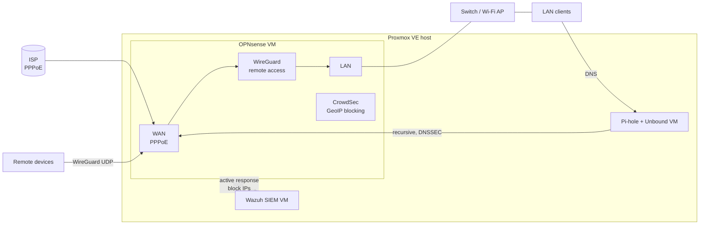

# Homelab: Proxmox Virtualisation & Network Security Build

A home lab running on **Proxmox VE** on repurposed hardware, with a virtualised **OPNsense** firewall, **Pi-hole + Unbound** for filtered, DNSSEC-validated DNS, **WireGuard** for remote access, and a **Wazuh SIEM** with automated response.

The lab was built about three years ago. In November 2026 I audited it from the live system (`pfctl`, `ss`, `sockstat`, Proxmox CLI) and documented it here, including the weaknesses the audit found and the plan to fix them.

> All addresses are private (RFC 1918) or examples. No keys, credentials or public IPs are published. See [Sanitisation](#sanitisation).

---

## Architecture

## What's in the lab

| Component | Role | Docs |
|---|---|---|
| Proxmox VE 8.4 | Type-1 hypervisor on repurposed gaming PC | [01](docs/01-hardware.md), [02](docs/02-proxmox-setup.md) |
| OPNsense 26.7 | Firewall, router, PPPoE, WireGuard server | [04](docs/04-opnsense-firewall.md) |
| CrowdSec, GeoIP, threat-intel aliases | Inbound and outbound blocking of known-bad IPs | [04](docs/04-opnsense-firewall.md) |
| Pi-hole v6 + Unbound | Network-wide DNS filtering, recursive DNSSEC resolver | [05](docs/05-dns-pihole-unbound.md) |
| WireGuard | Remote access – the only service open to the internet | [06](docs/06-vpn.md) |
| Wazuh | SIEM, alerting, active response into the firewall | [04](docs/04-opnsense-firewall.md), [07](docs/07-hardening.md) |

## Skills demonstrated

- **Virtualisation:** Proxmox install, VM provisioning, Linux bridges, virtual firewall with physically separated WAN/LAN
- **Network engineering:** PPPoE WAN, addressing, NAT, policy-based routing (Proton VPN egress, built and rolled back)
- **Network security:** default-deny firewalling, threat-intel blocking, least-privilege remote access
- **DNS security:** blocklist filtering, recursive resolution, DNSSEC validation, DNS rebinding protection
- **Security monitoring:** Wazuh SIEM with automated blocking
- **Auditing:** reviewing a live ruleset and configs, finding misconfigurations, prioritising fixes – see [09](docs/09-lessons-learned.md) and [10](docs/10-roadmap.md)
- **Change management:** versioned firewall config and a clean rollback of a failed change

## Documentation

| # | Doc |
|---|---|
| 01 | [Hardware](docs/01-hardware.md) |
| 02 | [Proxmox setup](docs/02-proxmox-setup.md) |
| 03 | [Network design](docs/03-network-design.md) |
| 04 | [OPNsense firewall](docs/04-opnsense-firewall.md) |
| 05 | [DNS: Pi-hole + Unbound](docs/05-dns-pihole-unbound.md) |
| 06 | [VPN](docs/06-vpn.md) |
| 07 | [Hardening checklist](docs/07-hardening.md) |
| 08 | [Backup & recovery](docs/08-backup-recovery.md) |
| 09 | [Lessons learned](docs/09-lessons-learned.md) |
| 10 | [Roadmap](docs/10-roadmap.md) |

## Sanitisation

- Public IPs, PPPoE credentials, VPN keys and account details are never committed.
- Config exports are scrubbed with [`configs/sanitise.sh`](configs/sanitise.sh) and checked by hand.
- Screenshots are cropped or blurred to remove MAC addresses, public IPs and email addresses.
- Personal allow/deny-list entries are summarised by category, not published.

## Certifications

CompTIA A+ · CompTIA Network+ · CompTIA Security+
