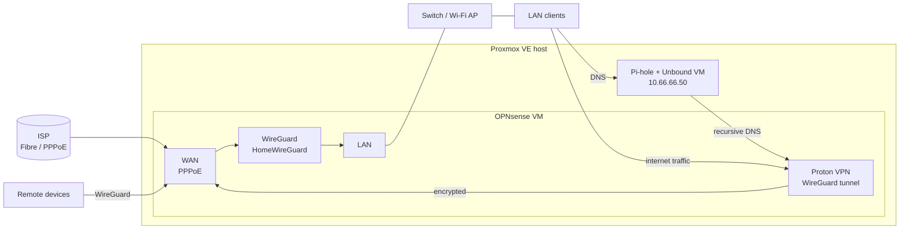

# Homelab: Proxmox Virtualisation & Network Security Build

A self-built home lab running on **Proxmox VE**, with a virtualised **OPNsense** firewall, **Pi-hole + Unbound** for private, filtered DNS, **Proton VPN** as the egress path for LAN traffic, and a **WireGuard** server for secure remote access.

I built this to get hands-on practice with the things I studied for CompTIA A+, Network+ and Security+: segmentation, firewalling, DNS security, VPNs, hardening and documenting a system so someone else could run it.

> All IP addresses, hostnames and keys in this repository are sanitised or examples. No secrets are committed. See [Sanitisation](#sanitisation).

---

## Architecture



**Traffic flow in one sentence:** clients send DNS to Pi-hole (ad/malware filtering, then recursive resolution through Unbound), and all LAN internet traffic is policy-routed by OPNsense out through a Proton VPN tunnel, so the ISP sees only encrypted VPN traffic.

## What's in the lab

| Component | Role | Docs |
|---|---|---|
| Proxmox VE | Type-1 hypervisor hosting all VMs | [02-proxmox-setup](docs/02-proxmox-setup.md) |
| OPNsense 26.7 | Firewall, router, PPPoE, VPN gateway | [04-opnsense-firewall](docs/04-opnsense-firewall.md) |
| Pi-hole + Unbound | Network-wide DNS filtering + recursive resolver | [05-dns-pihole-unbound](docs/05-dns-pihole-unbound.md) |
| Proton VPN (WireGuard) | Encrypted egress for all LAN traffic | [06-vpn](docs/06-vpn.md) |
| WireGuard server | Remote access back into the home network | [06-vpn](docs/06-vpn.md) |

## Skills demonstrated

- **Virtualisation:** Proxmox install, VM provisioning, virtual bridges, NIC passthrough / bridging for a virtual firewall
- **Network engineering:** PPPoE WAN, IP addressing, DHCP, gateway groups, policy-based routing
- **Network security:** default-deny firewall rules, DNS leak prevention, VPN kill-switch behaviour, least-exposure remote access
- **DNS security:** filtering with Pi-hole, recursive resolution with Unbound (no third-party resolver sees full query history)
- **Hardening:** management-plane lockdown, SSH keys, MFA, update process — see [07-hardening](docs/07-hardening.md)
- **Troubleshooting & documentation:** real problems I hit and how I fixed them — see [09-lessons-learned](docs/09-lessons-learned.md)

## Repository layout

```
.
├── README.md
├── docs/
│   ├── 01-hardware.md
│   ├── 02-proxmox-setup.md
│   ├── 03-network-design.md
│   ├── 04-opnsense-firewall.md
│   ├── 05-dns-pihole-unbound.md
│   ├── 06-vpn.md
│   ├── 07-hardening.md
│   ├── 08-backup-recovery.md
│   ├── 09-lessons-learned.md
│   └── 10-roadmap.md
├── configs/          # sanitised example configs
├── diagrams/         # exported network diagrams
└── screenshots/      # redacted screenshots of dashboards/rules
```

## Sanitisation

Before anything is committed:

- Public IPs, PPPoE credentials, VPN private keys and pre-shared keys are removed.
- Config exports are scrubbed with [`configs/sanitise.sh`](configs/sanitise.sh) and checked by hand.
- Screenshots are cropped/blurred to remove MAC addresses, public IPs and device names.

Publishing a homelab without leaking it is part of the exercise.

## Roadmap

Next up: VLAN segmentation (IoT / trusted / management), routing WireGuard remote clients out through Proton VPN, centralised logging and an IDS (Suricata). Full list in [10-roadmap](docs/10-roadmap.md).

## Certifications

CompTIA A+ · CompTIA Network+ · CompTIA Security+
